# Стратег

Агент для руководителя цифрового продукта
Работает как обычная папка в любом агентном хосте — IDE или CLI с LLM, чтением файлов и терминалом


## Первый запуск

Нужны Python 3.10+ и агентный хост с чтением файлов и терминалом
Для локального демо ключи, пакеты и платные сервисы не нужны
Стоимость модели зависит от вашего хоста

```bash
python3 scripts/demo.py
python3 scripts/work.py status demo
```

Откройте папку в хосте и напишите:

```text
Продолжи проект demo
Сначала покажи, что известно, что нужно проверить и какой следующий шаг
Ничего не запускай во внешних системах
```

Правила в `AGENTS.md` подхватывают хосты, которые читают этот стандартный файл; `CLAUDE.md` подключает те же правила для Claude Code
Навыки лежат в `.agents/skills` — хосты с поддержкой навыков находят их сами, в остальных агент открывает нужный `SKILL.md` по пути из `AGENTS.md`
Не переносите весь репозиторий в один промпт

Для новой задачи:

```text
Начни проект projects/my-product
Запрос: [ваш вопрос]
Материалы: [доступные файлы]
Сначала уточни только то, без чего нельзя сделать следующий шаг
```

Личные проекты в `projects/` и проверочные прогоны в `runs/` не попадают в Git
Перед первой записью в другую папку добавьте её в `.gitignore`

## Что получится

- Картина ситуации с фактами, гипотезами, прогнозами и пробелами
- Минимум три разных пути, включая сохранение состояния и закрытие направления
- Возражения, условная рекомендация и выбор человека
- Продуктовая и коммуникационная стратегии в одном `strategy.md`
- План проверки с метрикой, сравнением, окном и нежелательными последствиями
- Запись решения с владельцем, сроком, показателем и условием пересмотра

Готовый пример: [стратегия Евы](demo/strategy.md)
Отдельно сохранены [результат реальной LLM](demo/live/strategy.md), [её состояние](demo/live/state.json) и [ответ обычного чата](demo/baseline.md)

## Как работает


На каждом шаге агент выбирает вопрос, инструмент и проверку результата
Этапы помогают ориентироваться, но не запрещают вернуться назад
Человек нужен для бюджета, передачи своих материалов, выбора и запуска действий




`state.json` хранит не «прежний ответ модели», а типизированные записи со ссылками на основания
Новые записи заменяют старые через `supersedes`, история не стирается
Отзыв основания помечает зависимые выводы для пересмотра, а не объявляет их ложными


| Запись | Обязательные поля |
| --- | --- |
| claim | `id`, `type`, `text`, `refs`, для факта ещё `locator` |
| option | `id`, `approach`, `text`, `refs`, `objections` |
| decision | `id`, `text`, `refs`, `option`, `owner`, `due`, `metric`, `trigger`, `approval` |

Типы утверждений: `fact`, `hypothesis`, `forecast`, `unknown`
Происхождение источника: `open`, `own`, `synthetic`
Согласование: `pending`, `approved`, `example`
Для `approved` нужны `approved_by` и `approval_ref` — инструмент проверяет поля, личность и согласие проверяет человек
Варианты обязаны включать `status_quo`, `close` и хотя бы ещё один механизм
Разные формулировки одной рекламы не считаются разными механизмами

## Навыки

| Навык | Когда нужен | Что даёт |
| --- | --- | --- |
| brief | Размытый запрос | Вопрос решения, цель, ограничения и источники |
| research | Не хватает основания | План от решающих вопросов и проверенные ссылки |
| data | Таблицы и метрики | Проверка данных и воспроизводимый расчёт |
| interview | Интервью и модельные роли | Вопросы о реальных случаях, разбор и границы синтетики |
| ux | Экраны и путь | Видимые наблюдения с областью или таймкодом |
| options | Выбор направления | Разные механизмы и сильные возражения |
| product | Продуктовый выбор | Аудитория, задача, альтернативы, отказы и экономика |
| message | Объяснение ценности | Барьер, сообщение, подтверждение и роль каналов |
| test | Проверка гипотез | Протокол сравнения и защитные показатели |
| decision | Выбор сделан | Основания, обязательства и пересмотр |
| update | Появились сведения | Затронутые выводы без потери истории |
| resume | Перерыв или новый чат | Восстановление из файлов без повторного старта |

## Инструменты

| Скрипт | Возможности | Границы |
| --- | --- | --- |
| `work.py` | Состояние, источники, граф связей, поиск, решения, расходы | Нет сети, не исполняет текст материалов |
| `read.py` | TXT, Markdown, CSV и DOCX | Не распознаёт сканы, не вычисляет формулы |
| `data.py` | Доли когорт, стандартизация состава и SRM двух групп | Не доказывает причинность и не считает мощность |
| `demo.py` | Повторяемый учебный проход и пересмотр | Не вызывает LLM, не выдаётся за живую работу агента |
| `live.py` | Проверка реальной LLM в двух новых сеансах и обычного чата | Отдельно нужен поддержанный CLI-хост и ваш тариф |
| `draw.mjs` | UML в SVG через Pele | Node.js нужен только для обновления схем |

У каждого скрипта есть `--help`

## Сбои и защита

- Состояние заменяется атомарно, один писатель удерживает блокировку
- Одинаковый `--key` с тем же действием не создаёт повторную запись
- Неизвестные ссылки, выход за папку проекта и недопустимые записи отклоняются
- Хеши копий выявляют изменение материала, но не подтверждают истинность текста
- Отзыв основания распространяется по графу, а история сохраняется
- После сбоя сначала `status` и `check`; платный запрос не повторяйте, пока не проверили завершение
- Незарегистрированный файл не является основанием; не удаляйте блокировку, пока писатель не остановлен

## Что нужно для работы

| Компонент | Роль | Обязателен |
| --- | --- | --- |
| LLM вашего хоста | План, анализ, стратегия и проверка смысла | Да, тариф и доступ предоставляет пользователь |
| Python 3.10+ | Данные, память и проверки | Да, без внешних пакетов |
| Веб-инструмент хоста | Поиск и чтение открытых сайтов | Нет, можно работать с сохранёнными выдержками |
| CLI-хост `codex` или `claude` | Повторение живой проверки `live.py` | Нет |
| Node.js 20+ и Pele | Обновление UML-схем | Нет, SVG уже сохранены |

### Результаты проверки

Проверено 18 ноября 2026 года, измерения и события в [proof.json](demo/proof.json)

| Способ | Время стены | Результат |
| --- | --- | --- |
| Обычный чат, без инструментов | 31,722 с | Текст с вариантами и двумя стратегиями |
| Агент, первый сеанс | 166,629 с | Источник, утверждения, четыре варианта, стратегия и пауза |
| Агент, новый сеанс | 74,662 с | Продолжение из файлов, учебное D1 и пересмотр после отзыва H1 |
