# Стратег

Агент для руководителя цифрового продукта
Работает как папка в Cursor или другой IDE с LLM и инструментами
Сам выбирает следующий шаг, сохраняет основания и возвращается к решению после новых данных
Это не отдельный бот и не автономный сервис

## Первый запуск

Нужны Python 3.10+ и IDE с агентным режимом, чтением файлов и терминалом
Для локального демо ключи, Python-пакеты и платные сервисы не нужны
Стоимость модели зависит от вашей IDE

```bash
python3 scripts/demo.py
python3 scripts/work.py status demo
```

Откройте эту папку в Cursor и напишите:

```text
Прочитай AGENTS.md
Продолжи проект demo
Сначала покажи, что известно, что нужно проверить и какой следующий шаг
Ничего не запускай во внешних системах
```

В Cursor навыки находятся в `.agents/skills`
В Claude Code файл `CLAUDE.md` подключает те же правила
В другой среде явно приложите `AGENTS.md` и попросите читать нужные навыки по пути
Не переносите весь репозиторий в один промпт

Для новой задачи:

```text
Прочитай AGENTS.md и начни проект projects/my-product
Запрос: [ваш вопрос]
Материалы: [доступные файлы]
Сначала уточни только то, без чего нельзя сделать следующий шаг
```

Личные проекты в `projects/` и проверочные прогоны в `runs/` не попадают в Git
Перед первой записью в другую папку добавьте её в `.gitignore`

## Что получится

- Картина ситуации с фактами, гипотезами, прогнозами и пробелами
- Минимум три разных пути, включая сохранение состояния и закрытие направления
- Возражения, условная рекомендация и выбор человека
- Продуктовая и коммуникационная стратегии в одном `strategy.md`
- План проверки с метрикой, сравнением, окном и нежелательными последствиями
- Запись решения с владельцем, сроком, показателем и условием пересмотра

Готовый пример: [стратегия Евы](demo/strategy.md)
Это учебная работа на открытых материалах, не стратегия, согласованная МегаФоном
Отдельно сохранены [результат реальной LLM](demo/live/strategy.md), [её состояние](demo/live/state.json) и [ответ обычного чата](demo/baseline.md)

## Как работает


На каждом шаге агент выбирает вопрос, инструмент и проверку результата
Этапы помогают ориентироваться, но не запрещают вернуться назад
Человек нужен для бюджета, передачи своих материалов, выбора и запуска действий
Вопросы без влияния на ближайший шаг агент откладывает



| Слой | Где | Зачем |
| --- | --- | --- |
| Постоянные правила | `AGENTS.md` | Процесс, доказательства, безопасность и согласования |
| Повторяемые процедуры | `.agents/skills/` | Загружаются по задаче, не занимают весь контекст |
| Метод | `knowledge/method.md` | Подходы и границы применимости |
| Материалы задачи | `ПРОЕКТ/inbox/`, `materials/` | Входные файлы и сохранённые копии |
| Память | `ПРОЕКТ/state.json` | Источники, связи, решения, события и следующий шаг |
| Результат | `ПРОЕКТ/strategy.md` | Читаемая рекомендация |

`state.json` не превращает прежний ответ модели в факт
Тип утверждения и ссылка на основание сохраняются отдельно
Новые записи могут заменить старые, но не стирают их
Изменение статуса источника помечает зависимые выводы для проверки

## Навыки

| Навык | Когда нужен | Что даёт |
| --- | --- | --- |
| brief | Размытый запрос | Вопрос решения, цель, ограничения и источники |
| research | Не хватает основания | План от решающих вопросов и проверенные ссылки |
| data | Таблицы и метрики | Проверка данных и воспроизводимый расчёт |
| interview | Интервью и модельные роли | Вопросы о реальных случаях, разбор и границы синтетики |
| ux | Экраны и путь | Видимые наблюдения с областью или таймкодом |
| options | Выбор направления | Разные механизмы и сильные возражения |
| product | Продуктовый выбор | Аудитория, задача, альтернативы, отказы и экономика |
| message | Объяснение ценности | Барьер, сообщение, подтверждение и роль каналов |
| test | Проверка гипотез | Протокол сравнения и защитные показатели |
| decision | Выбор сделан | Основания, обязательства и пересмотр |
| update | Появились сведения | Затронутые выводы без потери истории |
| resume | Перерыв или новый чат | Восстановление из файлов без повторного старта |

Это инструкции для LLM, а не обещание детерминированного качества
Агент проверяет структуру программно, смысл и соответствие источникам проверяют модель и человек

## Инструменты

| Скрипт | Возможности | Границы |
| --- | --- | --- |
| `work.py` | Состояние, источники, граф связей, поиск, решения, расходы | Нет сети, не исполняет текст материалов |
| `read.py` | TXT, Markdown, CSV и DOCX | Не распознаёт сканы, не вычисляет формулы |
| `data.py` | Доли когорт, стандартизация состава и SRM двух групп | Не доказывает причинность и не считает мощность |
| `demo.py` | Повторяемый учебный проход и пересмотр | Не вызывает LLM, не выдаётся за живую работу агента |
| `live.py` | Проверка реальной LLM в двух новых сеансах и обычного чата | Отдельно нужен Claude Code и ваш тариф |
| `draw.mjs` | UML в SVG через Pele | Node.js нужен только для обновления схем |

У каждого скрипта есть `--help`
Python-инструменты используют стандартную библиотеку
Документы и таблицы импортируются из разрешённых файлов
Сайты читает агент через веб-инструмент хоста, затем сохраняет выдержку с адресом и локатором
Недоступный формат требует экспорта или отдельно согласованного инструмента

### Состояние

```bash
python3 scripts/work.py init projects/test \
  --goal "Выбрать следующий шаг" --owner "Руководитель продукта" \
  --allow example.org --budget-usd 0
python3 scripts/work.py source projects/test \
  --id S1 --file inbox/source.md --kind open \
  --url https://example.org/product --locator "Условия" --key source-1
python3 scripts/work.py record projects/test --kind claim \
  --json '{"id":"C1","type":"fact","text":"Сайт заявляет функцию","refs":["S1"],"locator":"Условия"}' \
  --key claim-1
python3 scripts/work.py checkpoint projects/test \
  --stage research --next "Проверить независимое возражение" --key research-1
```

До `source` сохраните материал в `projects/test/inbox/source.md`
Пример `example.org` показывает синтаксис, не является исследованным источником
Скрипт проверяет точный домен, но сам не загружает страницу

| Запись | Обязательные поля |
| --- | --- |
| claim | `id`, `type`, `text`, `refs`, для факта ещё `locator` |
| option | `id`, `approach`, `text`, `refs`, `objections` |
| decision | `id`, `text`, `refs`, `option`, `owner`, `due`, `metric`, `trigger`, `approval` |

Типы утверждений: `fact`, `hypothesis`, `forecast`, `unknown`
Происхождение источника: `open`, `own`, `synthetic`
Согласование: `pending`, `approved`, `example`
Для `approved` нужны `approved_by` и `approval_ref`
Инструмент проверяет наличие полей, но не может удостоверить личность или согласие человека
Не кладите личные данные в поле согласования

Для вариантов обязательны `status_quo`, `close` и хотя бы ещё один механизм
Разные формулировки одной рекламы не считаются разными механизмами
`supersedes` связывает новую запись с заменяемой записью того же вида
Старый ID не перезаписывается

### Перерыв и новые данные

```bash
python3 scripts/work.py pause demo --next "Вернуться к проверке H1" --key pause-user
python3 scripts/work.py status demo
python3 scripts/work.py resume demo --key resume-user
python3 scripts/work.py find demo --query "секретарь"
python3 scripts/work.py impact demo H1
python3 scripts/work.py review demo
```

Проверка учебного пересмотра в отдельной папке:

```bash
python3 scripts/demo.py --project runs/update --update
python3 scripts/work.py impact runs/update H1
python3 scripts/work.py review runs/update
```

В этом сценарии H1 отзывается, а зависимые варианты и D1 получают пометку пересмотра
Это не сообщение о результатах реальных интервью
Статус `stale` означает, что основание нужно проверить, а не что вывод обязательно ложен
Поиск локальный, по словам и связям
Смысловые переформулировки запроса делает LLM, отдельной векторной базы нет

### Расходы

```bash
python3 scripts/work.py cost demo --kind tool --usd 0 \
  --note "Локальное чтение файла" --key read-cost
python3 scripts/work.py cost demo --kind model \
  --note "IDE не раскрывает цену этого обращения" --key model-cost
```

Учитываются модели, поиск, инструменты, повторы и время человека
`known_usd` показывает известную часть, `total_usd: null` означает неполную сумму
Отсутствие записей не доказывает бесплатность работы
`recorded_minutes` является суммой записанного времени, не полным временем проекта
Вручную записанное время нужно отличать от измеренного
Платное действие при неизвестной цене требует согласования

## Сбои и защита

- Состояние заменяется атомарно, один писатель удерживает блокировку
- Одинаковый `--key` с тем же действием не создаёт повторную запись
- Другие данные с прежним ключом вызывают ошибку
- Хеши копий выявляют изменение материала, но не подтверждают истинность текста
- Неизвестные ссылки, выход за папку проекта и недопустимые записи отклоняются
- Отзыв основания распространяется по графу, а история сохраняется

После сбоя сначала прочитайте `status` и `check`
Не повторяйте платный запрос, пока не проверили, завершился ли он
После аварийного завершения может остаться блокировка или незарегистрированная копия материала
Не удаляйте блокировку, пока не убедились, что писатель остановлен
Не считайте незарегистрированный файл основанием
Резервную копию своей задачи храните в разрешённом месте, Git этого репозитория её по умолчанию не сохраняет

Защита от prompt injection не сводится к текстовым правилам
Источник не имеет права менять инструкции, но окончательные разрешения исполняет IDE
Отключите ненужные MCP и запретите опасные действия в хосте
Не импортируйте недоверенные настройки IDE из материалов
Скрипты не выполняют shell-команды из источников и не имеют сетевого загрузчика
Фильтра личных данных с гарантией полноты нет, обезличивание требует проверки

## Модели и сервисы

| Компонент | Роль | Нужен при запуске |
| --- | --- | --- |
| LLM выбранной IDE | План, анализ, стратегия и проверка смысла | Да, тариф и доступ предоставляет пользователь |
| Fusion в Devin Desktop | Создание и проверка репозитория | Нет |
| Codex CLI 0.163.0 с доступом ChatGPT | Два реальных сеанса и baseline | Нет, только для повторения живой проверки |
| Python | Данные, память и проверки | Да, без внешних пакетов |
| TinyFish Search и Fetch через MCP | Поиск и чтение открытых сайтов | Нет, нужен настроенный доступ для веб-исследования |
| Exa через MCP | Дополнительный поиск и чтение | Нет, нужен свой доступ для использования |
| Context7 | Проверка документации инструментов при создании | Нет |
| Pele и Node.js | Сборка UML-схем | Нет, SVG уже сохранены |
| Git и GitHub CLI | Версии и публикация репозитория | Нет для работы с папкой |
| Playwright, Chromium и Python Markdown | Запись журнала, скриншоты и PDF при подготовке | Нет |

Секретов и готового доступа к чужому аккаунту в проекте нет
Для веб-работы подключите инструменты средствами своей IDE и проверьте их права
Сам факт подключения MCP не разрешает выгрузку собственных материалов
Глубокое исследование TinyFish использовалось при создании, оно не запускается из проекта и может быть платным
Локальный lsearch не является зависимостью
Его проверка при создании завершилась ошибкой подключения браузера

Маршрутизация выбирает навык и инструмент
Автоматического выбора провайдера, Jev, отдельного классификатора и фонового мониторинга нет
Сроки проверяются командой `review` или при продолжении, не отдельным постоянно работающим процессом
События сохранения и отзыва запускают локальные проверки и обновление статусов
Отдельные постоянные субагенты не нужны для этого процесса

## Проверка и демо

```bash
python3 -m unittest discover -s tests -v
python3 scripts/demo.py --project runs/check
python3 scripts/demo.py --project runs/check
python3 scripts/demo.py --project runs/update --update
python3 scripts/work.py check demo
python3 scripts/data.py rates demo/data.csv --base before
```

Повторный проход проверяет ключи событий, а не заново проводит исследование
Учебный расчёт: общий показатель 40% → 35%, при исходном составе сегментов after даёт 45%
Это не данные удержания МегаФона
Проверки охватывают ссылки, отзыв оснований, повтор действий, паузу, сохранение, ограничения путей и расчёты
Они не являются доказательством безопасности любой IDE или качества любой стратегии

Для обновления схем:

```bash
npm ci
npm run diagrams
npm run diagrams:check
```

Node.js 20+ нужен только здесь
Версия Pele зафиксирована в `package-lock.json`

### Проверка реальной модели

`live.py` не нужен для повседневной работы
По умолчанию он запускает Codex CLI в песочнице без пользовательских MCP
Вариант Claude Code оставлен для среды с действующим входом
Проверки разрешений не отключаются
Логи остаются в исключённой из Git папке `runs`
Сначала проверьте свой тариф и доступ

```bash
python3 scripts/live.py baseline --host codex --run test
python3 scripts/live.py first --host codex --run test
python3 scripts/live.py next --host codex --run test
```

Каждая команда ограничена 240 секундами
Codex CLI не предоставляет денежного лимита и цены этого прогона
Для Claude Code можно явно передать `--host claude --budget-usd 2`
Это ограничение отчётной цены API, не обещание итогового списания по подписке
Достигнутый лимит не означает успешного выполнения
Повторный запуск с существующим логом запрещён, чтобы случайно не повторить расход
Для осознанного нового прогона используйте новое имя `--run`
Первый агентный сеанс сохраняет работу и паузу
Второй не получает историю чата, читает файлы и проверяет учебное изменение

Baseline получает тот же вопрос, описание продукта, бриф и таблицу, но без правил агента и инструментов
Агент дополнительно получает рабочие процедуры и возможность писать состояние
Это сравнение двух способов работы на одном примере, не изолированный тест одного промпта
Два сеанса агента выполняют больше работы, чем один ответ baseline
Не делайте общий вывод о скорости по одному прогону

До запуска заданы проверки результата:

- Существенные факты имеют проверяемый источник и место в нём
- Неподтверждённая потребность не названа установленным фактом
- Есть разные варианты, статус-кво, закрытие нового направления и возражения
- Продуктовое обещание не выходит за подтверждённые возможности
- План проверки содержит сравнение, окно и нежелательные последствия
- Новый сеанс продолжает работу из файлов без истории
- Отзыв H1 показывает зависимое решение и необходимость пересмотра

Скрипт сохраняет время стены, модель, usage и цену, сообщённую CLI
Он не ставит оценку стратегии автоматически
Полные расходы создания репозитория и реальное время аналитика этими числами не измеряются

### Результаты проверки

Проверено 18 ноября 2026 года
Измерения и события сохранены в [proof.json](demo/proof.json)
Повторно получать их для просмотра не нужно

| Способ | Время стены | Результат |
| --- | --- | --- |
| Обычный чат, без инструментов | 31,722 с | Текст с вариантами и двумя стратегиями |
| Агент, первый сеанс | 166,629 с | Источник, утверждения, четыре варианта, стратегия и пауза |
| Агент, новый сеанс | 74,662 с | Продолжение из файлов, учебное D1 и пересмотр после отзыва H1 |

Успешные два сеанса заняли 241,291 с
CLI сообщил 756 306 входных токенов, из них 675 200 кэшированных, и 10 860 выходных
Это накопленные счётчики обращений, не размер исходных материалов
Денежная стоимость и точное имя обслужившей модели в журнале Codex отсутствуют
Использован выбор модели хоста по умолчанию, поэтому воспроизведение на другом аккаунте может отличаться

Время всех пяти запусков Codex, включая неудачные попытки и baseline, равно 446,366 с
Сначала Claude Code отказал из-за истёкшего OAuth
Затем первая версия сценария Codex ошибочно запрещала ему читать файлы через терминал
Сценарий исправлен под инструменты хоста
Добавлена проверка артефактов, поскольку успешный ответ API не означал завершённую задачу
После исправления в двадцати выполненных командах двух успешных сеансов ошибок исполнения не было

Оба способа дали осторожную рекомендацию и не выдали учебную таблицу за данные МегаФона
Агент не оказался быстрее обычного чата
Его подтверждённое отличие здесь: сохранённое состояние, продолжение без истории и связь отзыва H1 с D1
Один пример не доказывает преимущество на других задачах
В живом результате осталось согласовать срок наблюдения и пороги проверки, он не готов к запуску
Внешние страницы в этих двух сеансах не открывались, использовалась заранее проверенная выдержка
Свежесть ссылок и полноту стратегии по-прежнему проверяет человек

Локальные проверки: 41 тест, повторяемое демо и сборка двух UML-схем
Это не оценка стратегии жюри и не тест всех возможных атак

### Видео и документ

[Видео демонстрации](assets/demo.webm) показывает просмотр сохранённого журнала реальных двух сеансов
В нём видны запрос, инструменты, стратегии и продолжение
Это просмотр уже выполненной работы, не новый вызов модели
Запись не доказывает реальный спрос, проведение интервью или согласование МегаФоном
Для подачи видео нужно загрузить на площадку из списка организатора
Версия описания для отправки: [README.pdf](README.pdf)


## Готовность к подаче

Репозиторий содержит инструкции, метод, 12 навыков, локальные инструменты, исходные материалы и две стратегии в одном документе
Официальный дополнительный бриф конкурса в исходном запросе отсутствует
Его нужно подставить вместо учебного перед окончательной подачей

Нельзя считать выполненными без отдельных свидетельств:

- Реальные интервью с согласием участников
- Эксперимент, доказавший спрос или влияние на бизнес
- Измерение полного выигрыша относительно аналитика вручную
- Полный денежный расход при скрытой цене IDE
- Публикацию видеозаписи на площадке, которую принимает организатор

Сценарий записи до 10 минут: запрос, источники и пробелы, разные варианты, две стратегии, сохранение, новый чат, новые данные и пересмотр
Запись только `demo.py` показывает инструменты, но не подтверждает самостоятельную работу LLM
Описание архитектуры, перечень инструментов, ограничения и ключевые инструкции находятся в этом README и связанных файлах

## Источники

Прочитано 18 ноября 2026 года
Методы адаптированы к задаче, это не утверждение о внутренних стандартах МегаФона
Сроки, ID, формат состояния и правила блокировок являются решениями этого проекта

| Источник | Что взято | Ограничение |
| --- | --- | --- |
| [МегаФон, Ева](https://moscow.megafon.ru/services/security/eva/) | Описание секретаря и условия функций | Заявления поставщика, московская страница, не метрики качества |
| [МегаФон, UX-лаборатория](https://moscow.megafon.ru/help/info/popular/ux_research/) | Наличие пользовательских исследований | Не результаты исследования нашего сценария |
| [РБК, Александр Соболев, 31.08.2021](https://trends.rbc.ru/trends/innovation/cmrm/6123a67d9a79476d474f2d38) | Публичное описание фабрики и прототипов | Историческое интервью, не текущий регламент |
| [GOV.UK, Discovery](https://www.gov.uk/service-manual/agile-delivery/how-the-discovery-phase-works) | Проблема до решения, границы и допустимость остановки | Метод государственного сервиса адаптирован к продукту |
| [Product Talk, Opportunity Solution Trees, 06.12.2023](https://www.producttalk.org/opportunity-solution-trees/) | Результат, потребности, варианты и проверки | Нельзя придумывать потребности без входных данных |
| [Product Talk, Five Types of Assumptions, 11.10.2023](https://www.producttalk.org/five-types-of-assumptions/) | Спрос, экономика, реализуемость, удобство и этика | Перечень вопросов, не доказательство наших гипотез |
| [Government Communications, OASIS](https://www.communications.gov.uk/publication/oasis-planning-government-communications/) | Цель, аудитория, подход, исполнение и оценка | Источник для коммуникаций, не внутренний стандарт оператора |
| [Microsoft Research, SRM, 14.09.2020](https://www.microsoft.com/en-us/research/articles/diagnosing-sample-ratio-mismatch-in-a-b-testing/) | Проверка распределения до интерпретации A/B | Порог конкретной платформы не универсален |
| [Microsoft Azure, ADR](https://learn.microsoft.com/en-us/azure/well-architected/architect-role/architecture-decision-record) | Контекст, альтернативы, последствия и замена без удаления | Управление обязательствами добавлено в проекте |
| [NN/g, Synthetic Users](https://www.nngroup.com/articles/synthetic-users/) | Синтетика для гипотез, не замена реальным людям | Не общий тест всех нынешних и будущих моделей |
| [Anthropic, Building Effective Agents](https://www.anthropic.com/research/building-effective-agents) | Простые инструменты, маршрутизация и проверка | Общие принципы, не руководство по актуальному SDK |
| [OWASP, Prompt Injection](https://cheatsheetseries.owasp.org/cheatsheets/LLM_Prompt_Injection_Prevention_Cheat_Sheet.html) | Недоверенные материалы и проверка границ инструментов | Одни инструкции не образуют песочницу |
| [OWASP, MCP Security](https://cheatsheetseries.owasp.org/cheatsheets/MCP_Security_Cheat_Sheet.html) | Минимальные права и проверка схем и параметров | Защита зависит от хоста и сервера |
| [Cursor, Skills](https://cursor.com/docs/skills) и [Rules](https://cursor.com/docs/rules) | Пути навыков и AGENTS.md | Поддержка другой IDE проверяется отдельно |
| [Pele API](https://pele.run/api.md) | `render` и экспорт SVG | Синтаксис Mermaid, рендерер именно Pele |
| [Claude Code CLI](https://code.claude.com/docs/en/cli-reference) | Неинтерактивная проверка и ограничение инструментов | Не обязательная среда пользователя |

Исследование использовало Exa, TinyFish Search и Fetch, затем [углублённый отчёт TinyFish с 63 ссылками](https://agent.tinyfish.ai/research/01a1eeef-093e-7d13-8c63-28768df444d5)
Число ссылок отчёта не равно числу независимо проверенных фактов
Его выводы не принимались автоматически
Например, в нём отсутствовал найденный отдельно материал РБК, а коммуникационный метод потребовал отдельного первоисточника OASIS
Цены, статистика и рекомендации из непроверенных пересказов не переносились в стратегию
